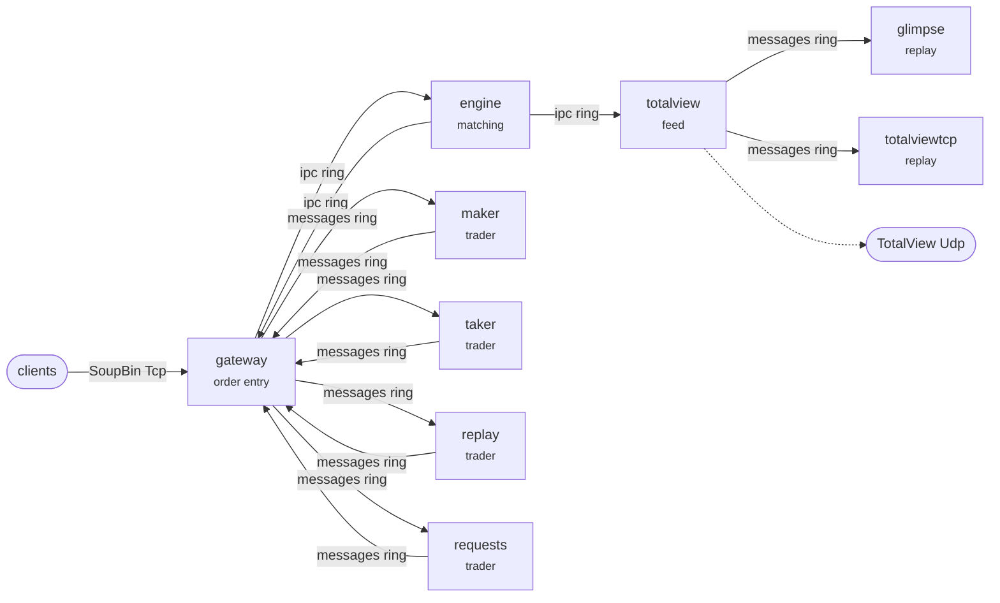

# Nasdaq Stock Market — the components

One process per component, and every link between them a ring in shared memory carrying framed
Nasdaq.NsmEquities.MatchingEngine.Ipc.v2026 messages. The components are the same ones the single binary under `../process/`
runs as threads — they come from `../common/` — so the only difference between the two versions is
what a component writes to.

| Binary | Here | What it is |
| --- | --- | --- |
| `nasdaq_system_gateway` | `gateway/` | order entry over Tcp, a session per client, the orders it has admitted |
| `nasdaq_system_engine` | `engine/` | the book: it matches what it is sent and emits what happened |
| `nasdaq_system_totalview` | `totalview/` | the totalview feed: engine events through its transforms, out as multicast and into the recording |
| `nasdaq_system_glimpse` | `glimpse/` | the Glimpse service: the snapshot of TotalView a client logs in for |
| `nasdaq_system_totalviewtcp` | `totalviewtcp/` | the TotalViewTcp service: the stream of TotalView a client logs in for |
| `nasdaq_system_maker` | `maker/` | the trader Maker, a maker trading through the venue's own order entry |
| `nasdaq_system_taker` | `taker/` | the trader Taker, a taker trading through the venue's own order entry |
| `nasdaq_system_replay` | `replay/` | the trader Replay, a capture trading through the venue's own order entry |
| `nasdaq_system_requests` | `requests/` | the trader Requests, a capture trading through the venue's own order entry |
| `nasdaq_rings` | `rings/` | makes the links, and removes them: run by `launch.sh`, not by hand |

## The topology



The same graph is in `topology.dot`, for a picture rather than a sketch:

```bash
dot -Tsvg topology.dot -o topology.svg
```

Both come from the exchange's own declaration, so neither can go stale against what was built.

## Running it

```bash
cmake -S .. -B ../build -DCMAKE_BUILD_TYPE=Release
cmake --build ../build --parallel

bash launch.sh ../build          # up, until interrupted
```

`launch.sh` makes the rings, starts the components, and on the way out stops them and removes the
rings. Do not start the components by hand unless you have made the rings first: a component only
ever attaches to a ring, and says so if it is not there.

That is also why the rings are made by a binary rather than by the script. The links are a **cycle**
— the gateway writes to the engine and the engine writes back, and each trader likewise — so there
is no order to start the components in where every reader finds its writer already up. And the size
of a ring is `sizeof(Layout)` in `../common/run/SharedRing.hpp`, which a shell cannot know.

Stopping is ordered the other way, in producer order: traders, then the gateway, then the engine,
then the feeds. A component stopped before the one feeding it has drained would lose whatever was
still on the ring.

## Two things to know before you rely on it

**It is not reproducible.** Every component runs free, and nothing can see that the venue has gone
quiet, so the same run gives different numbers each time. The single binary under `../process/`
takes turns and settles between them, which is what makes *its* counts a fixed number — so a change
is checked against that one, and this one shows the venue working as separate processes.

**Ctrl-C only works in the foreground.** A script started as a background job inherits `SIGINT`
ignored, and bash cannot trap a signal that was ignored when it started — so `bash launch.sh &`
followed by `kill -INT` does nothing at all. Run it in the foreground and Ctrl-C behaves; from a
script, send `SIGTERM`, which is never ignored:

```bash
bash launch.sh ../build &
kill -TERM %1                    # SIGINT would be ignored here
```

## What it needs

Posix shared memory: `shm_open` and `mmap`. The single binary builds anywhere its compiler does;
this version is Linux and the Unixes, and the rings live under `/dev/shm`. A run that ends badly
leaves them there, which costs nothing — `launch.sh` unlinks each ring before it makes it, so the
next run starts on an empty one either way.