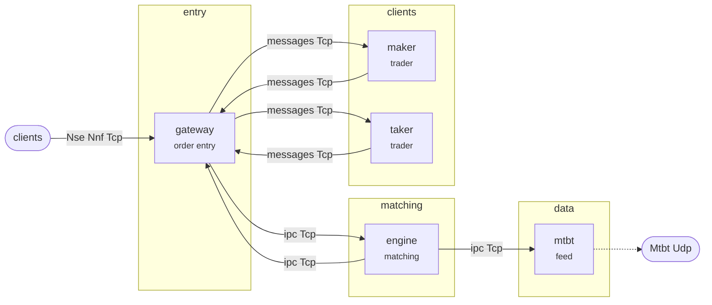

# Nse Futures and Options — the components, across machines

One process per component again, but across machines: every link between them is Tcp carrying the
same framed Nse.NseFo.MatchingEngine.Ipc.v1.0 messages the other two versions carry in a queue and in a ring. The
components are the same code from `../common/`, built against a different adapter — which is the
reason there are three versions of a venue and one implementation of it.

A tier is a machine, or a set of machines that may as well be one. The matching engine is on its
own and so is recovery, because what the venue matches and what tells a client where to resume
should not fail at the same moment.

This is the only version whose links can fail. A queue and a ring cannot lose a message, write
half of one, or go away; Tcp does all three. So a link here carries a sequence and reports a gap
to its reader rather than handing on a stream with a hole in it. It does **not** hold history or
serve a resume — that is what the recovery tier is for, and a second copy of it inside the link
would be the wrong place for it.

| Binary | Here | Machine | What it is |
| --- | --- | --- | --- |
| `nse_cluster_gateway` | `gateway/` | `entry` | order entry over Tcp, a session per client, the orders it has admitted |
| `nse_cluster_engine` | `engine/` | `matching` | the book: it matches what it is sent and emits what happened |
| `nse_cluster_mtbt` | `mtbt/` | `data` | the mtbt feed: engine events through its transforms, out as multicast and into the recording |
| `nse_cluster_maker` | `maker/` | `clients` | the trader Maker, a maker trading through the venue's own order entry |
| `nse_cluster_taker` | `taker/` | `clients` | the trader Taker, a taker trading through the venue's own order entry |

## The topology



The same graph is in `topology.dot`, for a picture rather than a sketch:

```bash
dot -Tsvg topology.dot -o topology.svg
```

Both come from the exchange's own declaration, so neither can go stale against what was built.

## Running it

Two ways, and they are for different questions.

**On this machine**, which answers whether the components work over sockets at all:

```bash
cmake -S .. -B ../build -DCMAKE_BUILD_TYPE=Release
cmake --build ../build --parallel

bash launch.sh ../build          # up, until interrupted
```

Every component runs here and the links are loopback. It is a smoke test of the distributed venue
rather than the distributed venue: nothing is on its own machine, so nothing can fail on its own.
The launcher passes `--config ../simulator.ini`, whose link hosts are `127.0.0.1`.

**Across containers**, which answers whether the tiers work when they really are apart:

```bash
docker compose -f compose.yaml up --build        # one container per component
docker compose -f compose.yaml logs -f engine     # what the matching tier is doing
docker compose -f compose.yaml down
```

Each component is a service on a container network, and every link host is the name of the service
that reads it — Docker's own resolver turns that into wherever the container is. Nothing in the
image knows an address, which is the point: the same image runs the same component on another
machine by being told a different name.

Taking a tier away is how recovery is exercised:

```bash
docker compose -f compose.yaml stop engine        # the matching tier goes
docker compose -f compose.yaml start engine        # and comes back
```

The components either side keep running. What was in flight is lost — a producer that dies with
messages buffered loses them whatever the link believes — and the reader reports the gap rather
than carrying on as though the stream were whole.

## Two things to know before you rely on it

**It is not reproducible.** Every component runs free, and nothing can see that the venue has gone
quiet, so the same run gives different numbers each time. The single binary under `../process/`
takes turns and settles between them, which is what makes *its* counts a fixed number — so a change
is checked against that one, and this one shows the venue working as separate processes.

**Ctrl-C only works in the foreground.** A script started as a background job inherits `SIGINT`
ignored, and bash cannot trap a signal that was ignored when it started — so `bash launch.sh &`
followed by `kill -INT` does nothing at all. Run it in the foreground and Ctrl-C behaves; from a
script, send `SIGTERM`, which is never ignored:

```bash
bash launch.sh ../build &
kill -TERM %1                    # SIGINT would be ignored here
```

## What it needs

Posix sockets, and for the container route Docker with Compose. Nothing shared: no shared memory,
no shared filesystem, no shared clock. That is what makes this the version that can be spread over
real machines — and what makes it the one where a component can be somewhere else entirely, which
is the only honest way to test recovery.

The feeds are Udp multicast, which a bridged container network does not carry between hosts. A
client on another machine takes the stream off the recovery tier, which is Tcp, or shares the
feed container's network.